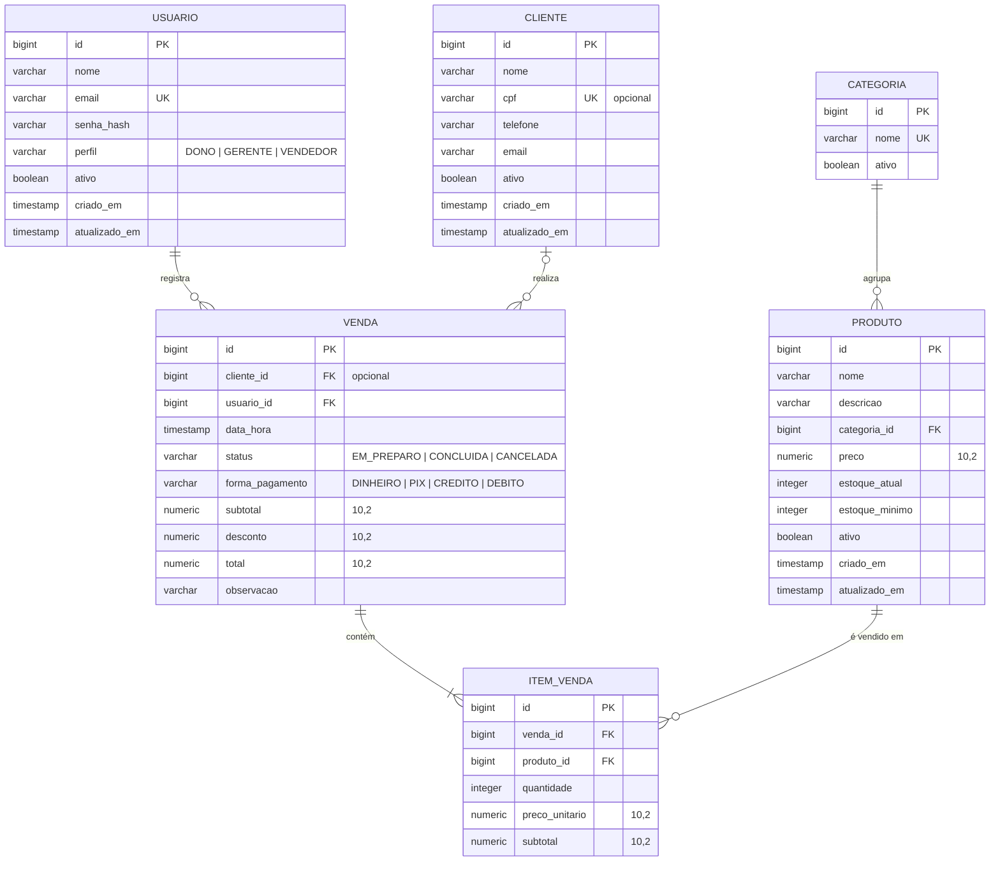

# Modelo de Dados

Proposta do banco de dados (PostgreSQL) do sistema **Ponto & Sabor**.

> **Status:** validado pela equipe (veja as decisões no final do documento).

## Diagrama entidade-relacionamento



## Tabelas

### `usuario`
São os **funcionários** que acessam o sistema. É a aba "Funcionários" do protótipo.

| Coluna | Tipo | Regras |
|---|---|---|
| `id` | BIGSERIAL | PK |
| `nome` | VARCHAR(120) | obrigatório |
| `email` | VARCHAR(150) | obrigatório, único (usado no login) |
| `senha_hash` | VARCHAR(100) | obrigatório, senha criptografada com **BCrypt** (nunca em texto puro) |
| `perfil` | VARCHAR(20) | `DONO`, `GERENTE` ou `VENDEDOR` |
| `ativo` | BOOLEAN | padrão `true` |
| `criado_em` / `atualizado_em` | TIMESTAMP | preenchidos automaticamente |

**Permissões por perfil:**

| Ação | Dono | Gerente | Vendedor |
|---|:---:|:---:|:---:|
| Registrar vendas | ✅ | ✅ | ✅ |
| Cadastrar clientes | ✅ | ✅ | ✅ |
| Cadastrar/editar produtos | ✅ | ✅ | ❌ |
| Cancelar vendas | ✅ | ✅ | ❌ |
| Ver dashboards estratégicos | ✅ | ✅ | ❌ |
| Gerenciar usuários | ✅ | ❌ | ❌ |

### `cliente`

| Coluna | Tipo | Regras |
|---|---|---|
| `id` | BIGSERIAL | PK |
| `nome` | VARCHAR(120) | obrigatório |
| `cpf` | VARCHAR(11) | opcional, único quando informado, só números, validado |
| `telefone` | VARCHAR(11) | opcional, só números |
| `email` | VARCHAR(150) | opcional, formato validado |
| `ativo` | BOOLEAN | padrão `true` |
| `criado_em` / `atualizado_em` | TIMESTAMP | automáticos |

### `categoria`
Exemplos: Lanches, Bebidas, Porções, Sobremesas. Serve para filtrar produtos e para gráficos de "vendas por categoria".

| Coluna | Tipo | Regras |
|---|---|---|
| `id` | BIGSERIAL | PK |
| `nome` | VARCHAR(60) | obrigatório, único |
| `ativo` | BOOLEAN | padrão `true` |

### `produto`

| Coluna | Tipo | Regras |
|---|---|---|
| `id` | BIGSERIAL | PK |
| `nome` | VARCHAR(120) | obrigatório |
| `descricao` | VARCHAR(500) | opcional |
| `categoria_id` | BIGINT | FK → `categoria`, obrigatório |
| `preco` | NUMERIC(10,2) | obrigatório, maior que zero |
| `estoque_atual` | INTEGER | maior ou igual a zero |
| `estoque_minimo` | INTEGER | abaixo disso, o produto aparece como **estoque baixo** |
| `ativo` | BOOLEAN | padrão `true` |
| `criado_em` / `atualizado_em` | TIMESTAMP | automáticos |

### `venda`
Representa tanto a **venda** quanto o **pedido**. O status mostra em que etapa ela está.

| Coluna | Tipo | Regras |
|---|---|---|
| `id` | BIGSERIAL | PK (também é o número do pedido) |
| `cliente_id` | BIGINT | FK → `cliente`, **opcional** (venda de balcão sem cadastro) |
| `usuario_id` | BIGINT | FK → `usuario`, quem registrou a venda |
| `data_hora` | TIMESTAMP | obrigatório, **indexado** (base dos dashboards) |
| `status` | VARCHAR(20) | `EM_PREPARO`, `CONCLUIDA` ou `CANCELADA` |
| `forma_pagamento` | VARCHAR(20) | `DINHEIRO`, `PIX`, `CREDITO` ou `DEBITO` |
| `subtotal` | NUMERIC(10,2) | soma dos itens |
| `desconto` | NUMERIC(10,2) | padrão 0, não pode passar do subtotal |
| `total` | NUMERIC(10,2) | `subtotal - desconto` |
| `observacao` | VARCHAR(500) | opcional (ex.: "sem cebola") |

### `item_venda`

| Coluna | Tipo | Regras |
|---|---|---|
| `id` | BIGSERIAL | PK |
| `venda_id` | BIGINT | FK → `venda` |
| `produto_id` | BIGINT | FK → `produto` |
| `quantidade` | INTEGER | maior que zero |
| `preco_unitario` | NUMERIC(10,2) | **cópia do preço no momento da venda** |
| `subtotal` | NUMERIC(10,2) | `quantidade × preco_unitario` |

## Decisões de projeto

1. **Exclusão lógica (`ativo = false`) em vez de apagar registros.** Um cliente ou produto com vendas não pode sumir do banco, senão o histórico e os dashboards ficam inconsistentes.
2. **Preço copiado para `item_venda`.** Se o preço do X-Burguer mudar amanhã, as vendas de hoje continuam com o valor correto.
3. **Valores monetários em `NUMERIC(10,2)`**, que vira `BigDecimal` no Java. Nunca usar `double`/`float`, que geram erros de arredondamento.
4. **Estoque baixa ao concluir a venda e volta se ela for cancelada.** Uma venda não pode ser concluída se faltar estoque.
5. **Dashboards contam só vendas `CONCLUIDA`.**
6. **Senhas com BCrypt** (Spring Security).

## Como os dashboards usam esses dados

Todos os indicadores saem de `venda` + `item_venda`, agrupando por `data_hora`:

| Dashboard | Agrupamento |
|---|---|
| Pico por **dia da semana** | `EXTRACT(DOW FROM data_hora)` |
| Pico por **horário** | `EXTRACT(HOUR FROM data_hora)` |
| Vendas no **mês** | `DATE_TRUNC('month', data_hora)` |
| Vendas no **semestre** | `EXTRACT(YEAR ...)` + `CASE WHEN EXTRACT(MONTH ...) <= 6 THEN 1 ELSE 2 END` |
| Vendas no **ano** | `EXTRACT(YEAR FROM data_hora)` |
| Produtos mais vendidos | `SUM(item_venda.quantidade)` por produto |
| Ticket médio | `AVG(venda.total)` |

Exemplo, pico de vendas por dia da semana no mês atual:

```sql
SELECT EXTRACT(DOW FROM data_hora) AS dia_semana,
       COUNT(*)                    AS quantidade_vendas,
       SUM(total)                  AS faturamento
FROM venda
WHERE status = 'CONCLUIDA'
  AND data_hora >= DATE_TRUNC('month', CURRENT_DATE)
GROUP BY dia_semana
ORDER BY faturamento DESC;
```

## Decisões validadas pela equipe

- [x] **CPF do cliente é opcional** (único quando informado).
- [x] **Sem endereço do cliente**: o sistema não terá delivery.
- [x] **Permissões por perfil** aprovadas conforme a tabela acima.
- [x] **Formas de pagamento:** apenas Dinheiro, PIX, Crédito e Débito.
- [x] **Estoque controlado para todos os produtos.**
