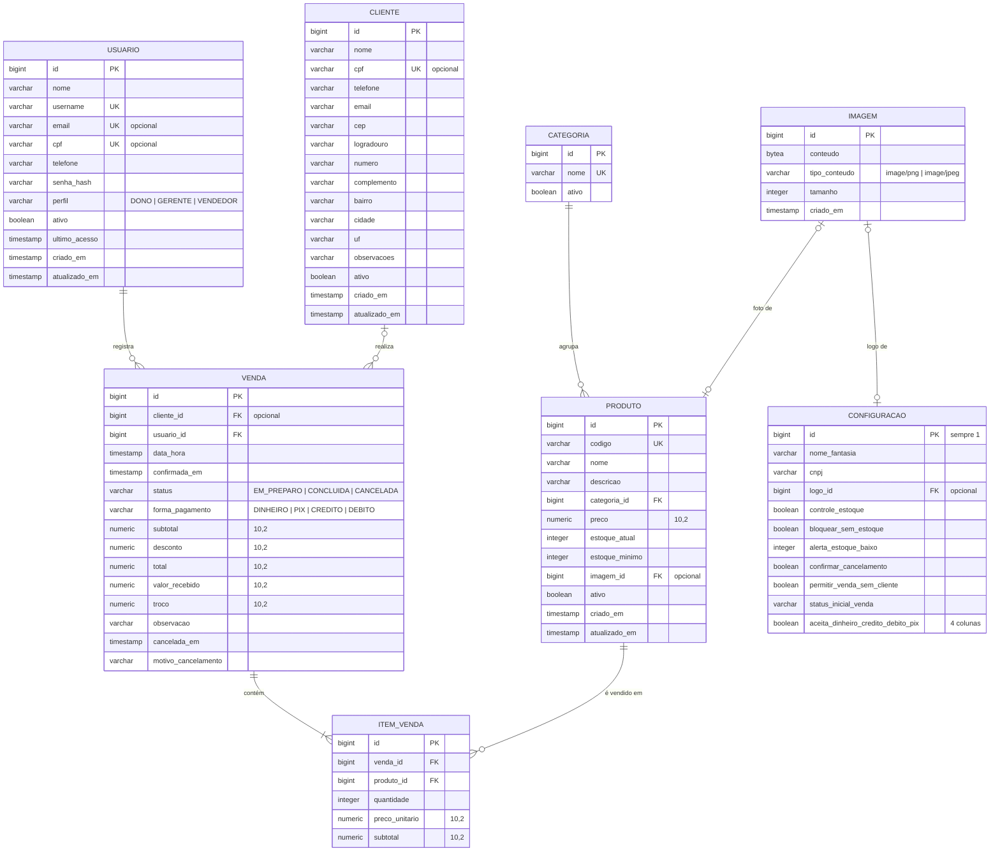

# Modelo de Dados

Modelo do banco de dados (PostgreSQL) do sistema **Ponto & Sabor**.

> **Status:** alinhado ao protótipo do Figma Make (versão 12), por decisão da equipe. Veja o
> [histórico de decisões](#histórico-de-decisões) no final.

## Diagrama entidade-relacionamento



## Tabelas

### `usuario`
São os **funcionários** que acessam o sistema (aba "Funcionários" da tela Cadastros). O login aceita
o **nome de usuário ou o e-mail**.

| Coluna | Tipo | Regras |
|---|---|---|
| `id` | BIGINT (identity) | PK |
| `nome` | VARCHAR(120) | obrigatório |
| `username` | VARCHAR(50) | obrigatório, único, minúsculo (`[a-z0-9._-]`, 3 a 50 caracteres) |
| `email` | VARCHAR(150) | opcional, único quando informado |
| `cpf` | VARCHAR(11) | opcional, único quando informado, validado |
| `telefone` | VARCHAR(11) | opcional, só números |
| `senha_hash` | VARCHAR(100) | obrigatório, **BCrypt**; a senha tem de 6 a 72 caracteres |
| `perfil` | VARCHAR(20) | `DONO`, `GERENTE` ou `VENDEDOR` |
| `ativo` | BOOLEAN | padrão `true` |
| `ultimo_acesso` | TIMESTAMP | preenchido a cada login |
| `criado_em` / `atualizado_em` | TIMESTAMP | automáticos |

### `cliente`
Só o **nome** é obrigatório.

| Coluna | Tipo | Regras |
|---|---|---|
| `id` | BIGINT (identity) | PK |
| `nome` | VARCHAR(120) | obrigatório |
| `cpf` | VARCHAR(11) | opcional, único quando informado, validado |
| `telefone` | VARCHAR(11) | opcional, só números (10 ou 11 dígitos) |
| `email` | VARCHAR(150) | opcional, formato validado |
| `cep` | VARCHAR(8) | opcional, só números |
| `logradouro`, `numero`, `complemento`, `bairro`, `cidade` | VARCHAR | opcionais |
| `uf` | VARCHAR(2) | opcional, 2 letras maiúsculas |
| `observacoes` | VARCHAR(500) | opcional (ex.: "Prefere contato pelo WhatsApp") |
| `ativo` | BOOLEAN | padrão `true` |
| `criado_em` / `atualizado_em` | TIMESTAMP | automáticos |

### `categoria`
Categorias do protótipo: **Hambúrgueres, Bebidas, Acompanhamentos, Combos e Sobremesas**.

| Coluna | Tipo | Regras |
|---|---|---|
| `id` | BIGINT (identity) | PK |
| `nome` | VARCHAR(60) | obrigatório, único |
| `ativo` | BOOLEAN | padrão `true` |

### `produto`
Obrigatórios: **nome, código, categoria e preço**.

| Coluna | Tipo | Regras |
|---|---|---|
| `id` | BIGINT (identity) | PK |
| `codigo` | VARCHAR(20) | obrigatório, único, maiúsculo (ex.: `XBG001`) |
| `nome` | VARCHAR(120) | obrigatório |
| `descricao` | VARCHAR(500) | opcional |
| `categoria_id` | BIGINT | FK → `categoria`, obrigatório |
| `preco` | NUMERIC(10,2) | obrigatório, maior que zero |
| `estoque_atual` | INTEGER | ≥ 0; padrão 0 |
| `estoque_minimo` | INTEGER | ≥ 0; abaixo ou igual a ele o produto aparece como **estoque baixo**. Se não for informado, usa o "alerta de estoque baixo" das configurações |
| `imagem_id` | BIGINT | FK → `imagem`, opcional (foto do produto) |
| `ativo` | BOOLEAN | padrão `true` |
| `criado_em` / `atualizado_em` | TIMESTAMP | automáticos |

### `venda`
Representa a **venda/pedido**. Ela é criada quando o vendedor **confirma** o pedido (após escolher a
forma de pagamento), já com o status inicial definido nas configurações.

| Coluna | Tipo | Regras |
|---|---|---|
| `id` | BIGINT (identity) | PK (também é o número do pedido) |
| `cliente_id` | BIGINT | FK → `cliente`; opcional se as configurações permitirem venda sem cliente |
| `usuario_id` | BIGINT | FK → `usuario`, quem registrou a venda |
| `data_hora` | TIMESTAMP | início do pedido, **indexado** (base dos dashboards) |
| `confirmada_em` | TIMESTAMP | momento da confirmação |
| `status` | VARCHAR(20) | `EM_PREPARO`, `CONCLUIDA` ou `CANCELADA` |
| `forma_pagamento` | VARCHAR(20) | `DINHEIRO`, `PIX`, `CREDITO` ou `DEBITO` (só as habilitadas nas configurações) |
| `subtotal` | NUMERIC(10,2) | soma dos itens |
| `desconto` | NUMERIC(10,2) | padrão 0, não pode passar do subtotal |
| `total` | NUMERIC(10,2) | `subtotal - desconto` |
| `valor_recebido` / `troco` | NUMERIC(10,2) | só para pagamento em **dinheiro** |
| `observacao` | VARCHAR(500) | opcional (ex.: "sem cebola") |
| `cancelada_em` | TIMESTAMP | preenchido no cancelamento |
| `motivo_cancelamento` | VARCHAR(500) | **obrigatório** ao cancelar |

### `item_venda`

| Coluna | Tipo | Regras |
|---|---|---|
| `id` | BIGINT (identity) | PK |
| `venda_id` | BIGINT | FK → `venda` |
| `produto_id` | BIGINT | FK → `produto` |
| `quantidade` | INTEGER | maior que zero |
| `preco_unitario` | NUMERIC(10,2) | **cópia do preço no momento da venda** |
| `subtotal` | NUMERIC(10,2) | `quantidade × preco_unitario` |
| `quantidade_baixada_estoque` | INTEGER | quanto saiu do estoque na confirmação (0 se o estoque não é controlado) |

### `configuracao`
Registro **único** (`id = 1`) com os dados da tela Configurações.

| Grupo | Colunas |
|---|---|
| Dados da lanchonete | `nome_fantasia` (obrigatório), `razao_social`, `cnpj` (validado), `telefone`, `email`, `cep`, `logradouro`, `numero`, `bairro`, `cidade`, `uf`, `logo_id` (FK → `imagem`) |
| Estoque | `controle_estoque` (padrão `true`), `bloquear_sem_estoque` (padrão `true`; só vale com o controle ligado), `alerta_estoque_baixo` (padrão 5) |
| Pedidos | `confirmar_cancelamento` (padrão `true`), `permitir_venda_sem_cliente` (padrão `true`), `status_inicial_venda` (`EM_PREPARO` ou `CONCLUIDA`) |
| Pagamentos | `aceita_dinheiro`, `aceita_credito`, `aceita_debito`, `aceita_pix` (pelo menos uma ligada) |

### `imagem`
Logo da lanchonete e fotos dos produtos, guardados **no próprio banco** (sem serviço externo, custo zero).

| Coluna | Tipo | Regras |
|---|---|---|
| `id` | BIGINT (identity) | PK; a imagem é servida em `/api/imagens/{id}` |
| `conteudo` | BYTEA | o arquivo em si, até **1 MB** |
| `tipo_conteudo` | VARCHAR(30) | `image/png` ou `image/jpeg`, detectado pelos primeiros bytes do arquivo |
| `tamanho` | INTEGER | em bytes |
| `criado_em` | TIMESTAMP | automático |

Cada troca cria uma imagem nova e apaga a anterior; como o endereço muda, o navegador pode guardar a
imagem em cache sem risco de mostrar uma versão antiga.

## Permissões por perfil

Conforme a tabela "Usuários e Permissões" do protótipo. As permissões são **fixas** por perfil.

| Funcionalidade | Dono | Gerente | Vendedor |
|---|:---:|:---:|:---:|
| Dashboard gerencial | ✅ | ✅ | ❌ |
| Realizar vendas | ✅ | ✅ | ✅ |
| Consultar os próprios pedidos | ✅ | ✅ | ✅ |
| Consultar todos os pedidos | ✅ | ✅ | ❌ |
| Cancelar pedidos | ✅ | ✅ | ❌ |
| Cadastrar clientes | ✅ | ✅ | ✅ |
| Editar clientes | ✅ | ✅ | ❌ |
| Gerenciar produtos | ✅ | ✅ | ❌ |
| Gerenciar funcionários | ✅ | ❌ | ❌ |
| Consultar e exportar relatórios | ✅ | ✅ | ❌ |
| Configurações gerais | ✅ | ❌ | ❌ |
| Minha conta (dados e senha) | ✅ | ✅ | ✅ |

Regras extras do protótipo:
- Ninguém pode alterar o próprio perfil nem desativar a própria conta.
- O sistema precisa ter sempre **pelo menos um Dono ativo**.

> As permissões são aplicadas pela API: o login gera um token JWT, e cada rota confere o perfil do
> usuário (lido do banco a cada requisição). Telas de vendas, pedidos e relatórios recebem as regras
> correspondentes quando essas APIs forem criadas.

## Fluxo da venda

1. O vendedor monta o carrinho, escolhe o cliente (ou não, se permitido) e aplica desconto.
2. Na revisão, escolhe a forma de pagamento; em dinheiro, informa o valor recebido e o sistema calcula o troco.
3. Ao **confirmar**, a venda é gravada com o status inicial das configurações e, se o controle de estoque
   estiver ligado, o estoque é baixado (bloqueando a venda sem estoque, se configurado).
4. Pedidos **Em preparo** podem ser marcados como **Concluídos**.
5. Ao **cancelar**, é obrigatório informar o motivo, e os produtos voltam ao estoque.

> Sem bloqueio de venda sem estoque, a confirmação retira só o que houver (o estoque nunca fica negativo);
> cada item guarda quanto saiu (`quantidade_baixada_estoque`) para devolver exatamente isso no cancelamento.
> Só **Dono e Gerente** dão desconto, concluem e cancelam; o **Vendedor** vê apenas os próprios pedidos.

## Decisões de projeto

1. **Exclusão lógica (`ativo = false`) em vez de apagar registros**, para não quebrar o histórico de vendas e os dashboards.
2. **Preço copiado para `item_venda`**: mudar o preço de um produto não altera vendas antigas.
3. **Valores monetários em `NUMERIC(10,2)`**, que vira `BigDecimal` no Java (nunca `double`/`float`).
4. **Documentos e telefones só com dígitos**: a API aceita com ou sem máscara.
5. **Dashboards contam só vendas não canceladas** (`EM_PREPARO` e `CONCLUIDA`).
6. **Senhas com BCrypt** (Spring Security).
7. **Mudanças no banco só por novas migrations** (`V1`, `V2`, `V3`...), nunca editando as antigas.

## Como os dashboards usam esses dados

Todos os indicadores saem de `venda` + `item_venda`, agrupando por `data_hora`:

| Dashboard | Agrupamento |
|---|---|
| Pico por **dia da semana** | `EXTRACT(DOW FROM data_hora)` |
| Pico por **horário** | `EXTRACT(HOUR FROM data_hora)` |
| Vendas no **mês** | `DATE_TRUNC('month', data_hora)` |
| Vendas no **semestre** | `EXTRACT(YEAR ...)` + `CASE WHEN EXTRACT(MONTH ...) <= 6 THEN 1 ELSE 2 END` |
| Vendas no **ano** | `EXTRACT(YEAR FROM data_hora)` |
| Produtos mais vendidos | `SUM(item_venda.quantidade)` por produto |
| Ticket médio | `AVG(venda.total)` |

Exemplo, pico de vendas por dia da semana no mês atual:

```sql
SELECT EXTRACT(DOW FROM data_hora) AS dia_semana,
       COUNT(*)                    AS quantidade_vendas,
       SUM(total)                  AS faturamento
FROM venda
WHERE status <> 'CANCELADA'
  AND data_hora >= DATE_TRUNC('month', CURRENT_DATE)
GROUP BY dia_semana
ORDER BY faturamento DESC;
```

## Histórico de decisões

**Primeira validação da equipe (modelo inicial):** CPF do cliente opcional, sem endereço, formas de
pagamento Dinheiro/PIX/Crédito/Débito, estoque controlado para todos os produtos.

**Alinhamento ao protótipo do Figma (migration `V3__alinhamento_prototipo_figma.sql`):** a equipe
decidiu seguir o Figma, o que mudou:

| Antes | Agora (Figma) |
|---|---|
| Cliente sem endereço | Endereço completo + observações |
| Usuário entrava só por e-mail (obrigatório) | Login por **nome de usuário** ou e-mail; e-mail opcional; CPF e telefone |
| Senha com mínimo de 8 caracteres | Mínimo de 6 |
| Produto sem código | **Código único** e imagem |
| Categorias Lanches, Bebidas, Porções, Sobremesas | Hambúrgueres, Bebidas, Acompanhamentos, Combos, Sobremesas |
| Estoque sempre controlado | Controle de estoque **configurável** |
| Formas de pagamento fixas | Formas de pagamento **habilitáveis** nas configurações |
| Cancelamento sem motivo | **Motivo obrigatório** |
| Estoque baixado ao concluir a venda | Estoque baixado ao **confirmar** a venda |
| Sem tela de configurações | Tabela `configuracao` (dados da lanchonete e preferências) |

**Upload de imagens (migration `V4__imagens.sql`):** as colunas `produto.imagem_url` e
`configuracao.logo_url` (que só guardavam endereços, sem upload) foram trocadas pela tabela `imagem`.

**Vendas (migration `V5__vendas.sql`):** `item_venda.quantidade_baixada_estoque` e índices para a tela de Pedidos.
